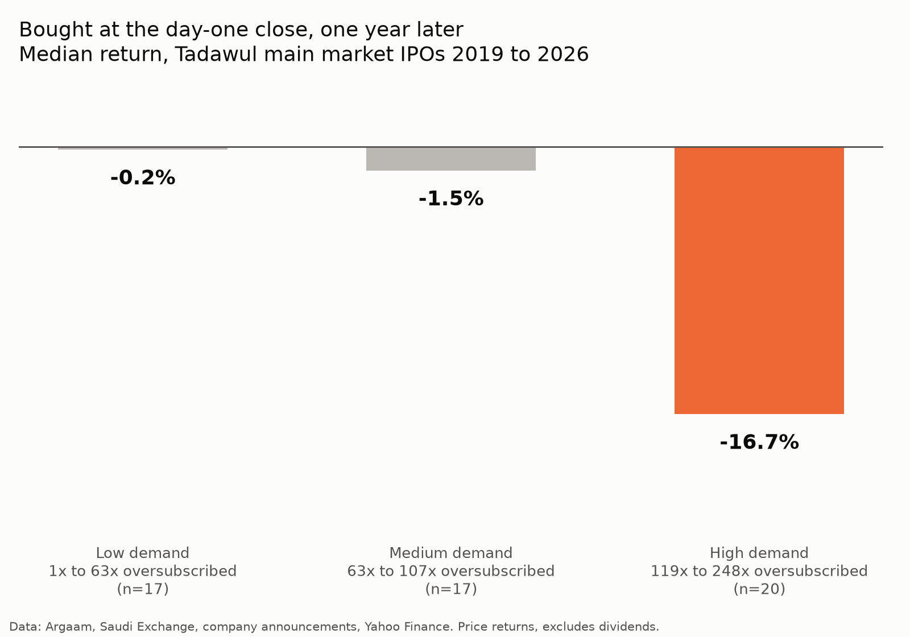

# Tadawul IPO Analysis

Analysis of how 61 Saudi Exchange (Tadawul) main market IPOs performed after listing, from 2019 to March 2026, and whether heavy oversubscription says anything about what comes next.



## Key findings

- 40 of 61 IPOs were above their offer price six months after listing.
- Overall there is no straight line relationship between oversubscription and six month returns (Spearman rho 0.02).
- The top third by demand (119x to 248x oversubscribed, 20 IPOs) rose a median 30% on the first day. Buying at that first close returned a median of -11.9% after six months and -16.7% after one year.
- Doing the same with the low and medium demand groups returned around +7% after six months and was roughly flat after one year (-0.2% and -1.5%).

These are medians from small groups (17 to 20 IPOs each), so read them as patterns rather than proof.

## Data

| File | Contents |
|---|---|
| `ipo_dataset.csv` | One row per IPO: ticker, listing date, sector, offer price, shares offered, offer size, institutional and retail oversubscription, first day close, source links for each figure and short notes |
| `excluded_ipos.csv` | IPOs removed from the analysis and why |
| `tasi_manual.csv` | TASI index daily closes, Dec 2018 to Nov 2026 |
| `ipo_returns.csv` | Output: returns at each checkpoint for every IPO |
| `summary.txt` | Output: the full results |

Sources:
- Offer prices, oversubscription, listing dates and first day prices come from Argaam, Saudi Exchange announcements, Arab News, Zawya and company press releases. Every row links to its source.
- Sectors follow the official Tadawul classification.
- Daily stock prices come from Yahoo Finance through `yfinance`.
- TASI history comes from Investing.com (2018 to 2022) and Stooq (2023 to 2026). The overlapping period was cross checked between the two.

## Method

1. Built the IPO list by hand from yearly IPO reviews and individual offering announcements.
2. Pulled daily prices for each stock and adjusted the offer price for later bonus shares and splits.
3. Counted every checkpoint from the real listing date using the TASI trading calendar, because Yahoo's history starts late for some stocks.
4. Calculated returns at day one, 3 months, 6 months and 1 year against the offer price, against the first day close, and against TASI over the same window.
5. Split IPOs into equal thirds by institutional oversubscription and compared medians.

## Run it

```
pip install yfinance pandas scipy matplotlib
python analyze_ipos.py
```

Results and charts are written to `output/`. Check `output/data_checks.csv` first: it lists every adjustment and data issue the script found.

## Limitations

- Returns are price returns and exclude dividends.
- The daily price limit on debut was 10% before 2021, so early IPOs like Aramco and BinDawood had smaller first day moves by design.
- Some first day prices are the debut price reported in the news rather than an explicitly labelled close. These rows are marked in the `first_day_is_reported_price` column.
- Amlak's first day close could not be found, so its day one value is blank.
- A few oversubscription figures were reported as overall coverage rather than institutional. Those IPOs were excluded (see `excluded_ipos.csv`).
- Saudi Aramco has no institutional coverage ratio, so it is left out of the demand groups.

This is a data project, not investment advice.

## Author

Mohammed | [LinkedIn](https://www.linkedin.com/in/m-alsubaie1)
